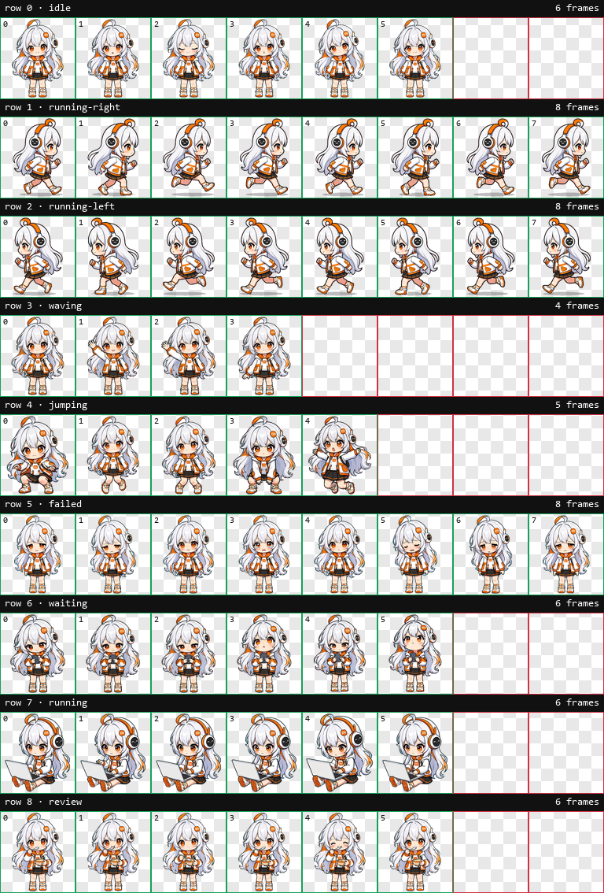

# Mimo 桌宠 (Mimo Pet)

一只会自己在 Windows 桌面上走动的小宠物，附带一整套生成 **Codex / ChatGPT 桌宠** 动画的工具。

## 下载（推荐）

**[📥 下载安装包 MimoPet-Setup-1.0.2.exe](https://github.com/Darry-cpu/mimo-pet/releases/latest)**

双击即可安装，**无需管理员权限、无需安装 Python**。全部版本见 [Releases](https://github.com/Darry-cpu/mimo-pet/releases)。

这个仓库包含两部分成果：

| 目录 | 内容 |
|---|---|
| `app/` | **独立桌宠应用**：自己在桌面上左右走动、能互动、可打包成一键安装包 |
| `generator/` | 生成动画图（图集）的脚本（需要你自己的图片服务凭据） |
| `skill/` | 对官方 `hatch-pet` 技能的补充脚本与改动说明 |
| `assets/` `previews/` | 成品动画图集与动作预览 |



**动作预览**：`previews/idle.gif`（待机）、`running-right.gif`、`running-left.gif`、`waiting.gif`（玩手机）、`review.gif`（吃饭）、`jumping.gif`。

---

## 一、桌宠应用（`app/`）

### 直接运行
```
python app/mimo_pet.py          # 需要 Python 3.10+ 且安装 Pillow
```
如果你拿到的是 **MimoPet.exe**（单文件版），双击即可，**不需要 Python**。

### 它会做什么

- **平时无人打扰**：安静地保持"玩手机"或"干活中"各约 30 秒
- 然后**随机方向、随机距离**走一段（约 220~620 像素），始终保持在同一条水平线上
- 走完再回到上一步，如此循环

### 怎么和它互动

| 操作 | 反应 |
|---|---|
| 单击 | 投喂 → 吃两口 |
| 双击 | 抚摸 → 高兴地跳 |
| 鼠标碰到但不点 | 打招呼 → 挥手 |
| 20~30 秒内连续挪动 3 次 | 它会沮丧 |
| 左键拖动 | 把它拎到桌面任意位置 |
| 右键 | 菜单：投喂 / 抚摸 / 暂停 / 放大 / 缩小 / 退出 |

9 套动画：待机、向右跑、向左跑、挥手、跳跃、沮丧、玩手机、干活中、吃饭中。

动作帧率沿用官方时间表，站立类动作额外放慢 1.6 倍，走动速度与脚步周期对齐，所以不会有滑步或"太快不自然"的感觉。

### 生成 Windows 安装包

需要 [Inno Setup 6](https://jrsoftware.org/isinfo.php)，脚本在根目录 `mimo_setup.iss`：

```
iscc mimo_setup.iss
```

产出单文件安装包，默认免管理员权限、安装到 `%LOCALAPPDATA%\Programs\MimoPet`，
可选创建桌面快捷方式与开机启动，并注册到系统的"应用和功能"里可卸载。

### 文件说明

- `mimo_pet.py` — 程序本体（Win32 分层窗口 + 逐帧动画 + 行为状态机）
- `mimo.ico` — 程序图标
- `使用说明.txt` — 给最终用户的中文说明（也随安装包一起安装）

---

## 二、Codex / ChatGPT 桌宠动画（`assets/` `generator/` `skill/`）

### 图集规格（Codex 宠物契约）

- PNG/WebP，`1536 x 1872`，`8` 列 × `9` 行，每格 `192 x 208`
- 透明背景，未使用格子必须全透明
- 每行帧数：`[6, 8, 8, 4, 5, 8, 6, 6, 6]`

| 行 | 状态 | 含义 |
|---|---|---|
| 0 | `idle` | 待机 |
| 1 | `running-right` | 向右跑 |
| 2 | `running-left` | 向左跑 |
| 3 | `waving` | 挥手 |
| 4 | `jumping` | 跳跃 |
| 5 | `failed` | 沮丧 |
| 6 | `waiting` | 玩手机 |
| 7 | `running` | 干活中 |
| 8 | `review` | 吃饭中 |

### 安装到 Codex / ChatGPT 桌面版

把图集放进宠物目录即可：

```
<CODEX_HOME>/pets/<宠物id>/
  ├── pet.json
  └── spritesheet.webp
```

`pet.json`：

```json
{
  "id": "mimo",
  "displayName": "Mimo",
  "description": "A cheerful Xiaomi Mimo chibi companion.",
  "spritesheetPath": "spritesheet.webp"
}
```

> 桌面版会把选中的自定义宠物同步到云端。**一旦同步，本地换图不会立即生效**——
> 需要换一个新的宠物 id（或在 App 里重新选择），它才会重新读取本地文件。

### `skill/` 目录（对官方技能的补充）

官方 [openai/skills](https://github.com/openai/skills) 的 `hatch-pet` 技能没有针对 **Windows + 没有 bash/jq** 的环境，
所以补了下面这些脚本：

| 脚本 | 作用 |
|---|---|
| `mark_job_complete.py` | 记录某个生成任务完成（替代 `jq` 更新 manifest） |
| `package_pet.py` | 打包 Codex `pet.json` 与 MiMo `manifest.json` 两套格式（替代 shell+jq） |
| `defringe_atlas.py` | **反解去蓝边**：色键抠图后半透明边缘残留青色，这个脚本把它们颜色反解干净 |
| `soften_ground_shadow.py` | 生成图自带一圈**青蓝色的脚底阴影**，跑动时脚下一团蓝；此脚本把它换成柔和的灰影（不碰角色本身） |
| `make_previews.py` | 从图集重新生成 `previews/` 里的动图与联系表——改了图集后跑一次，预览就和成品一致 |

详细改动见 `skill/SKILL-CHANGES.md`。

### `generator/` 目录

把动画图重新生成用的脚本（`regen_row.py` / `regen_idle_calm.py` 等）。

**它们需要访问图片服务的凭据，凭据不在本仓库里**——请通过配置文件提供（脚本默认从
MiMo Desktop 的配置文件读取，可用 `MIMO_CONFIG` 环境变量改成你自己的路径），
或自己改写 `api_key()`。工作目录用 `MIMO_PET_RUN` 指定。

生成经验（重要）：

1. **一行多帧必须一次生成**（3×2 或 4×2 网格）。分成两批生成会让细节漂移——
   实际踩过：耳机时隐时现、笔记本颜色黑银翻转、碗勺消失、整帧缩放。
2. 提示词要显式锁定不变量：同一个道具、同色、同大小、同位置；尺寸锁定（每帧身体大小一致）。
3. 长帧停留的格子（待机首尾帧）要放静态姿势，这样循环才顺。
4. 每帧末尾用首帧覆盖（`帧N = 帧0`）可让循环点变化为 0，视觉上无缝。

---

## 三、隐私

- 仓库**不含**任何 API 密钥、访问令牌、账号信息或本地绝对路径。
- 生成脚本从配置文件读取凭据，不写死。

## 四、许可

- `app/`、`generator/` 中的原创代码采用 MIT License。
- `skill/` 目录衍生自 [openai/skills](https://github.com/openai/skills) 的 `hatch-pet` 技能，
  遵循其 **Apache License 2.0**（见 `skill/LICENSE.txt`），原作版权归 OpenAI 所有。
